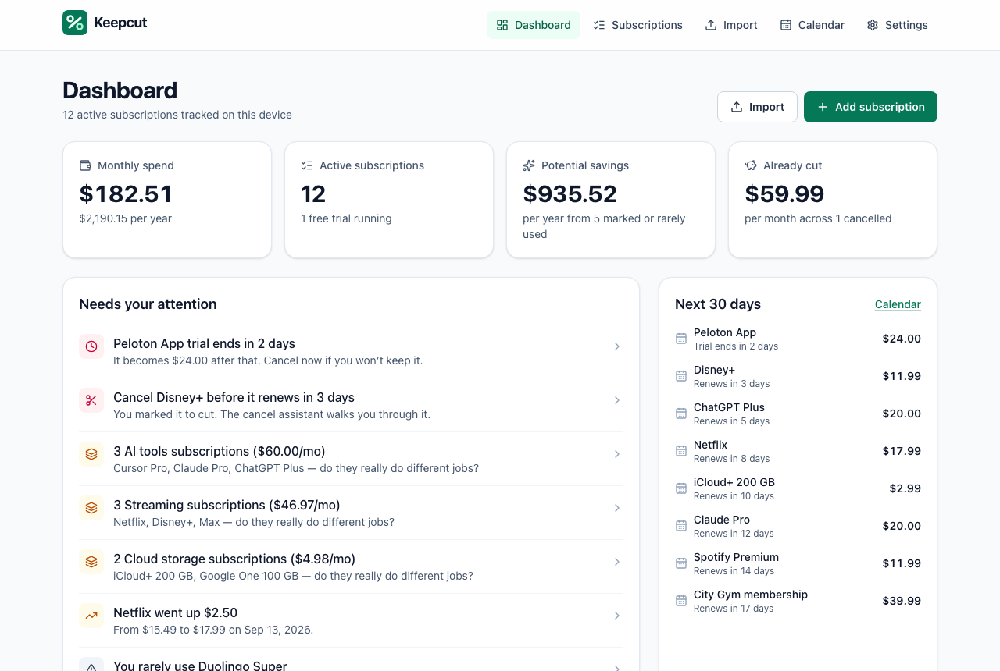
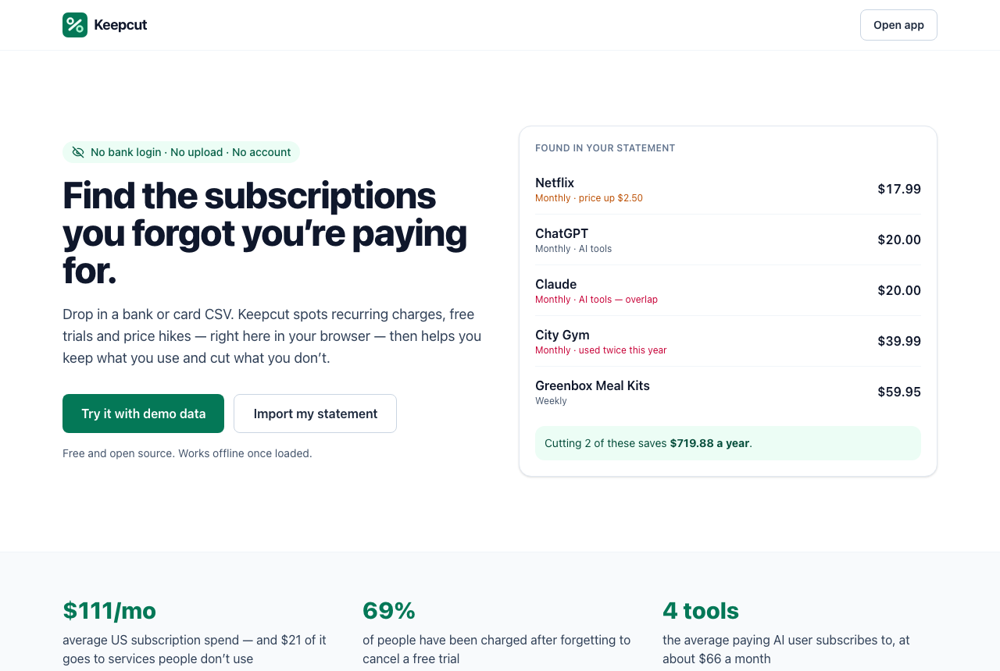
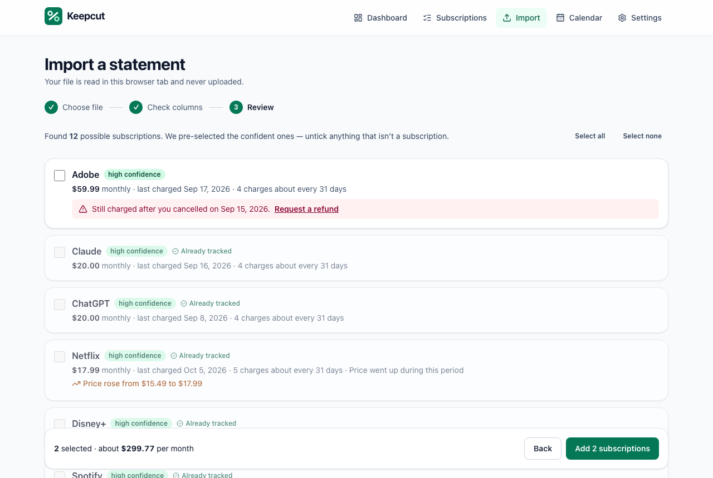
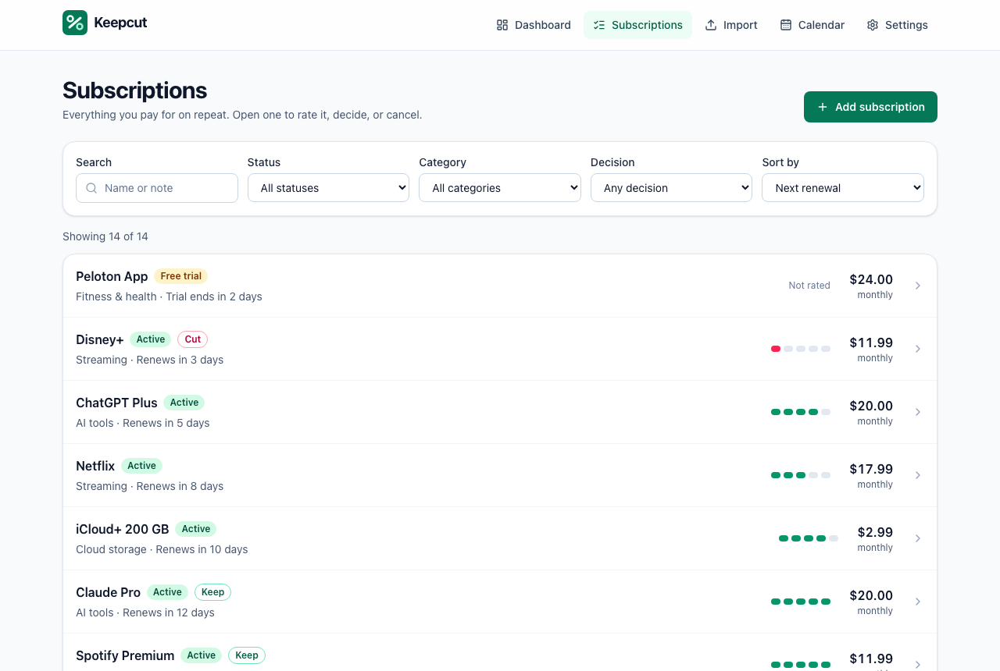
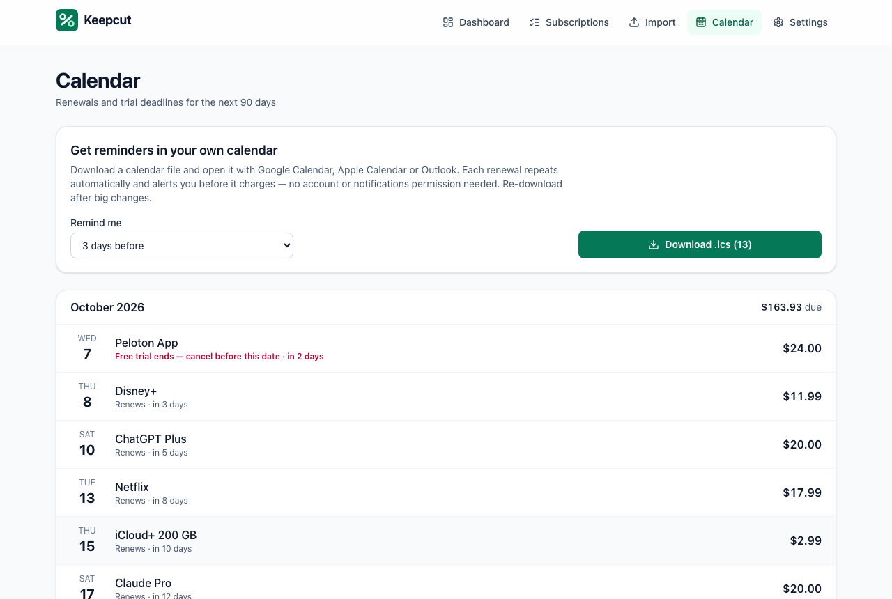
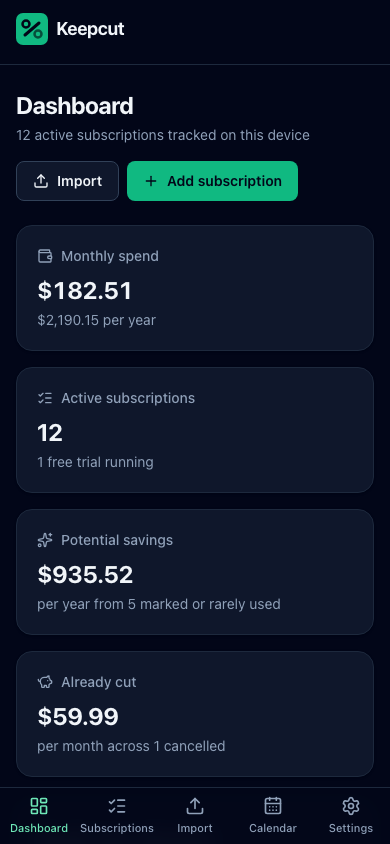

<div align="center">


# Keepcut

**Keep what you use. Cut what you don't.**

A privacy-first subscription and free-trial auditor. Drop in a bank or card CSV and Keepcut finds your recurring charges, free trials and price hikes — entirely in your browser. No bank login, no upload, no account.

[](https://github.com/dipak5501/keepcut/actions/workflows/ci.yml)
[](LICENSE)

</div>



## The problem

Subscriptions are easy to start and easy to forget. US consumers spend about **$111 a month** on subscriptions, and roughly **$21** of that goes to services they don't use ([CNET, 2026](https://www.cnet.com/tech/services-and-software/subscription-survey-2026/)). **69%** of people have been charged after forgetting to cancel a free trial ([BestMoney, 2026](https://www.bestmoney.com/credit-cards/learn-more/hidden-subscription-fees-survey)). AI tools have made it worse: paying users stack several overlapping assistants.

Existing trackers mostly fall into two camps:

- **Bank-linked apps** that want your banking credentials (via an aggregator) and store your transactions on their servers, often behind a paywall.
- **Manual lists** that only know about the subscriptions you already remember — which are not the ones costing you money.

## The solution

Keepcut reads the CSV export every bank already offers and detects recurring charges **on your device**. It then helps you act: rate how much you use each service, spot overlaps and price increases, get calendar reminders before renewals and trial ends, follow a cancellation checklist, keep proof of cancellation, and draft a refund request if you're charged anyway.

There is no server. Your statement is parsed in the browser tab and discarded; only the subscriptions you choose to keep are stored, in your browser's IndexedDB. A strict Content Security Policy prevents the app from contacting any other server.

See [docs/RESEARCH.md](docs/RESEARCH.md) for the market research and idea scoring, and [docs/DECISION.md](docs/DECISION.md) for why this product was chosen.

## Screenshots

| Landing                                                               | Import review                                                           |
| --------------------------------------------------------------------- | ----------------------------------------------------------------------- |
|                          |  |
| **Subscriptions**                                                     | **Calendar**                                                            |
|  |             |

<p align="center"></p>

## Features

- **On-device CSV import** — auto-detects delimiter, bank preamble lines, column mapping, date format (US, European, ISO, text months) and sign convention (signed amounts or debit/credit columns). Preview with per-row errors before anything is saved.
- **Recurring-charge detection** — groups by merchant, infers weekly / biweekly / monthly / quarterly / yearly / custom cycles, scores confidence, and recognises about 55 common services. Flags services that seem to have stopped.
- **Charged after cancelling** — if a statement shows charges after a cancellation you recorded, the import flags it and links straight to a refund-request letter.
- **Dashboard** — monthly and yearly spend, potential savings, money already cut, a "needs your attention" list (ending trials, items you marked to cut, overlaps, price increases, rarely-used services), next 30 days, and spend by category.
- **Keep-or-cut workflow** — rate usage 1–5, mark Keep / Cut / Undecided, filter and sort the list.
- **Cancellation assistant** — checklist, help-page search, copyable cancellation email, and a record of date, method and confirmation number.
- **Refund-request letter** generated from your cancellation record.
- **Calendar reminders** — download an `.ics` file with repeating events and alerts N days before each renewal and trial end. Works with Google, Apple and Outlook calendars; no notification permission needed.
- **Backups** — JSON, spreadsheet CSV (with formula-injection protection), and **encrypted backups** (AES-256-GCM, PBKDF2-SHA-256 with 600,000 iterations). Restore is fully validated.
- **Demo mode** — explore everything with realistic sample data or a generated sample bank statement.
- **Accessible and responsive** — keyboard-first, screen-reader labelled, WCAG 2.1 AA checked with axe in light and dark themes, mobile bottom navigation, reduced-motion support.
- **Works offline** once loaded; no cookies, analytics or third-party scripts.

## Try it

**Quick start**

```bash
git clone https://github.com/dipak5501/keepcut.git
cd keepcut
npm ci
npm run dev
```

Open the printed URL (usually http://localhost:5173) and click **Try it with demo data**, or go to **Import → Try a sample statement**.

**Using your own data:** export a CSV covering at least 3 months from your bank or card website, then drop it on the Import page. Nothing leaves your browser.

### Requirements

- Node.js 20.19+ (CI uses Node 22)
- A modern browser (Chrome, Edge, Firefox, Safari 16.4+)

## Configuration

Keepcut needs **no secrets and no external services**. One optional build-time variable is supported — copy `.env.example` to `.env.local`:

| Variable        | Purpose                                               | Default   |
| --------------- | ----------------------------------------------------- | --------- |
| `VITE_REPO_URL` | Shows a "Source code" link in the landing-page footer | not shown |

Never put secrets in `VITE_*` variables: they are embedded in the public JavaScript bundle.

## Tech stack

| Area    | Choice                                                                                   |
| ------- | ---------------------------------------------------------------------------------------- |
| UI      | React 19, React Router 8 (hash routing for static hosting), Tailwind CSS 4, lucide icons |
| Build   | Vite 8, TypeScript 6 (strict, `noUncheckedIndexedAccess`)                                |
| Data    | IndexedDB via Dexie 4 with live queries; Zod 4 validation on every write and restore     |
| Parsing | Papa Parse (CSV), date-fns                                                               |
| Crypto  | Web Crypto API (no third-party crypto code)                                              |
| Tests   | Vitest + Testing Library + fake-indexeddb, Playwright + axe-core                         |
| Quality | ESLint 10 (typescript-eslint, jsx-a11y, react-hooks), Prettier                           |

## Architecture

```
Browser tab
├── UI (React pages + components)
│     └── useAppData() ← live IndexedDB queries
├── Domain logic (pure TypeScript, fully unit-tested)
│     csv.ts → detect.ts → insights.ts
│     money.ts · dates.ts · merchants.ts · ics.ts · letters.ts · crypto.ts
└── Repository (single write path, Zod-validated)
      └── Dexie → IndexedDB (subscriptions, settings, imports)
```

Statements never touch the repository: they are parsed in memory, the user reviews detections, and only the selected subscriptions are written. Money is stored as integer minor units; dates as ISO `YYYY-MM-DD` strings.

More detail: [docs/ARCHITECTURE.md](docs/ARCHITECTURE.md) · module and data-format reference: [docs/API.md](docs/API.md) · product plan: [docs/PLAN.md](docs/PLAN.md).

## Testing

```bash
npm run lint          # ESLint (incl. accessibility rules)
npm run typecheck     # TypeScript, no emit
npm test              # 141 unit + integration tests (Vitest, jsdom, fake IndexedDB)
npm run test:coverage # with V8 coverage report
npm run build         # type-check + production build
npx playwright install chromium   # once
npm run test:e2e      # 16 end-to-end tests on desktop + mobile Chromium
npm audit             # dependency audit
```

The end-to-end suite runs against the **production build** and checks the demo walkthrough, sample-statement import, manual entry with validation, cancellation, calendar and encrypted-backup downloads, the Content Security Policy, that **no request leaves localhost**, axe WCAG 2.1 AA scans in light and dark mode, and horizontal overflow on a phone viewport.

Regenerate README screenshots with `SCREENSHOTS=1 npx playwright test screenshots --project=desktop`.

## Deployment

`npm run build` outputs a fully static site in `dist/` with relative asset paths and hash routing, so it works from any sub-path with no server configuration.

- **GitHub Pages:** the included [`deploy-pages.yml`](.github/workflows/deploy-pages.yml) workflow builds and publishes on every push to `main`. Enable it under _Settings → Pages → Source: GitHub Actions_.
- **Netlify / Vercel / Cloudflare Pages / any static host:** build command `npm run build`, output directory `dist`.

The Content Security Policy is injected as a `<meta>` tag at build time. If your host lets you set headers, you can additionally send it as an HTTP header (plus `frame-ancestors 'none'`, which meta tags can't express).

## Limitations

- **CSV only.** PDF statements and OFX/QFX files aren't supported yet.
- **Single currency.** Amounts are shown in one chosen currency; there is no conversion.
- **One device.** Data lives in one browser. Move it with (encrypted) backup and restore; there is no sync.
- **Detection is heuristic.** Irregular amounts (usage-based billing) or very short histories may be missed or need confirming; you always review before saving.
- **Reminders are calendar-based.** There are no push notifications, by design (no server).
- Cancellation help and letters are starting points, **not legal or financial advice**.

## Roadmap

- OFX/QFX and PDF statement import (on-device)
- Installable PWA with offline caching
- Multi-currency with manual exchange rates
- Shared household view via encrypted file exchange
- Locale-aware letter templates (e.g. UK/EU consumer-rights wording)
- Merchant list contributions from the community

## Contributing

Contributions are welcome — see [CONTRIBUTING.md](CONTRIBUTING.md). Please report security issues privately as described in [SECURITY.md](SECURITY.md). Release notes are in [CHANGELOG.md](CHANGELOG.md).

## License

[MIT](LICENSE) © 2026 Dipak Yadav

## Attributions

- Icons: [Lucide](https://lucide.dev) (ISC License)
- CSV parsing: [Papa Parse](https://www.papaparse.com) (MIT)
- IndexedDB wrapper: [Dexie.js](https://dexie.org) (Apache-2.0)
- Statistics on the landing page link to their original sources (CNET, BestMoney, Bango via Subnesio); see [docs/RESEARCH.md](docs/RESEARCH.md) for the full source list.
- Service names mentioned in the demo data and merchant list are trademarks of their respective owners and are used only to identify charges. Keepcut is not affiliated with any of them.
